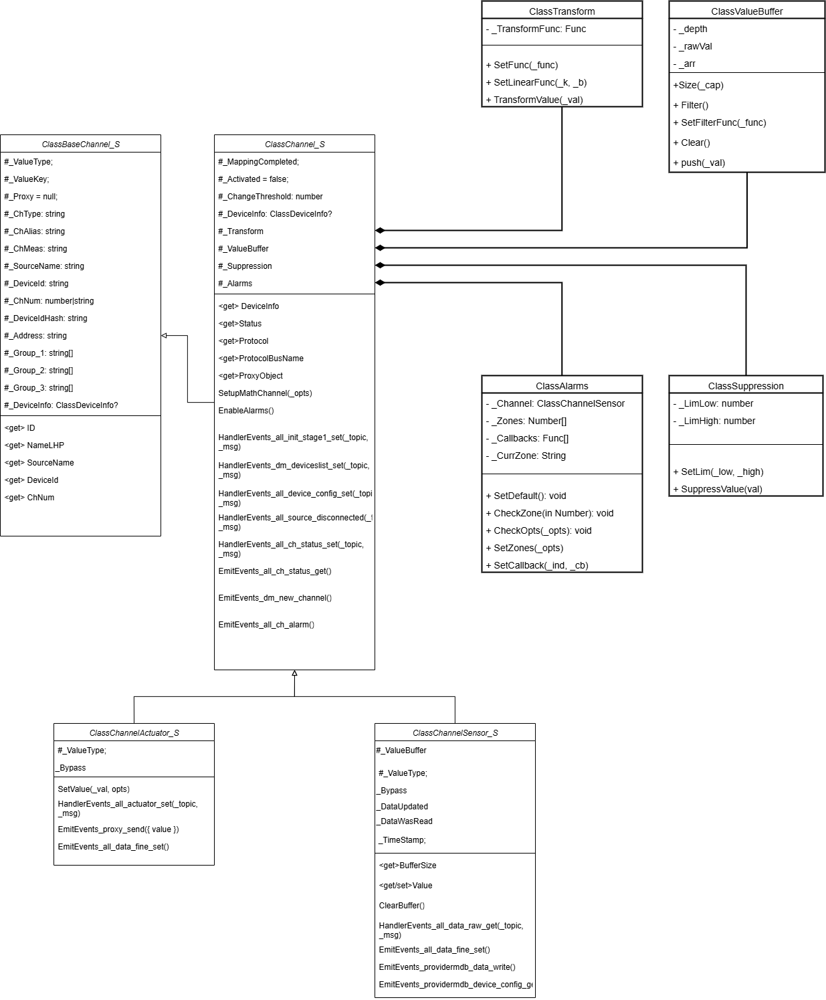

<div style="font-family: 'Open Sans', sans-serif; font-size: 16px">

# srvChannel
<div style="color: #555">
    <p align="center">
    
    </p>
</div>

## Лицензия
////

### Описание
<div style="color: #555">

**ClassBaseChannel_S** — это класс, представляющий каждый отдельно взятый канал сенсора или актуатора в качестве службы фреймворка. Он определяет основную структуру службы-канала: сохраняет обязательные конфигурационные свойства и геттеры, через которые классам-наследникам обеспечивается доступ к ним. 

<div style="color: #555">
<p align="center">

</p>
</div>

### Конструктор
<div style="color: #555">

- _busList - массив шины;
- _busNameList - список имен шин;
- _advOpts - объект, содержащий настройки канала (имя источника, идентификатор устройства и номер канала).

</div>

### Поля
<div style="color: #555">

- #_ValueType - тип данных, принимаемых каналом;
- #_ValueKey - имя ключа по которому принимаются данные или команда, если они поступили в виде JSON-строки;
- #_ChType - тип, 'actuator' | 'sensor';
- #_ChAlias - второе имя канала; 
- #_ChMeas - единица измерения;
- #_SourceName — идентификатор источника; если указан 'virtual', то приём и вовзрат обновлений замыкается на `dataBus`;
- #_ChNum — номер канала (начиная с 0);
- #_DeviceId — идентификатор устройства;
- #_DeviceIdHash - уникальный хэш, идентифицирующий модель актуатора;
- #_Address - топик, ассоциированный с каналом;
- #_Group_1, #_Group_2, #_Group_3 - списки групп/тэгов для группировки каналов; например, 
    ```{
        Name: 'lampHK1',
        Type: 'actuator',
        Groups_1: ['my_home', 'kitchen']
        Groups_2: ['light']
        Groups_3: ['evening']
    }
    ```

</div>

### Строковые каналы
<div style = "color: #555">

Если конфигурация канала содержит поле `valueType: "string"`, то значение **Value** канала считывается или сохраняется напрямую, в обход математической обработки. 

### Аксессоры

<div style="color: #555">

- get ID — возвращает уникальный идентификатор канала, сформированный хешем от имени канала;
- get SourceName — возвращает имя источника (например, брокера), с которым связан канал;
- get DeviceId — возвращает идентификатор устройства, к которому относится канал;
- get DeviceIdHash — возвращает хеш-идентификатор устройства;
- get ChNum — возвращает номер или идентификатор канала в контексте устройства;
- get ChAlias — возвращает псевдоним (alias) канала;
- get ChMeas — возвращает строковое обозначение единицы измерения показаний канала (например, "°C", "%", "В");
- get ChType — возвращает строковой тип канала: `"сенсор"` или `"актуатор"`;
- get ValueType — возвращает тип значения, передаваемого по каналу: `number` или `string`;
- get ValueKey — возвращает имя ключа, по которому поступают данные от источника;
- get Address — возвращает адрес канала в системе передачи данных (например, MQTT-топик или Modbus-адрес);
- get Group_1, `get Group_2`, `get Group_3` — возвращают значения групповой принадлежности канала, применяемые для логической классификации;
- get Status — возвращает объект текущего статуса `{ enabled, sourceConnected, active }`;
- get Enabled — возвращает административный статус канала (включен/отключен);
- get SourceConnected — возвращает статус подключения источника данных канала;
- get Active — возвращает результирующий рабочий статус канала (enabled && sourceConnected);
- get SourceOk — возвращает sourceConnected (для обратной совместимости).

<div style="color: #555">

**ClassChannel_S** — это класс, представляющий каждый отдельно взятый канал сенсора или актуатора в качестве службы фреймворка. Он определяет основную структуру службы-канала: сохраняет обязательные конфигурационные свойства и геттеры, через которые классам-наследникам обеспечивается доступ к ним. 

### Конструктор
- _busList - массив шины;
- _busNameList - список имен шин;
- _advOpts - объект, содержащий настройки канала (имя источника, идентификатор устройства и номер канала).

Пример конфигурации:
```js
{ 
    ChStatus: "active", 
    ChType:   "sensor",  
    Name:     "mqtt-Temp1",    
    ChMeas:   "C",      
    SourceName: "Broker01", 
    DeviceId:   "adam",   
    ChNum: 2, 
    DeviceHash: "e8fb-b1b0-2899-488d", 
    Address:    "Advantech/00D0C9F712B4/data", 
    ValueKey:   "ai3", 
    Config: { transform: { k: 100, b: -50.0 } },
    SavingValues: { raw: false, fine: false }
}
```

### Поля
- #_Enabled — административный статус канала (включен/отключен пользователем или командой);
- #_SourceConnected — статус физической доступности источника данных;
- #_Active — результирующий рабочий статус канала (`enabled && sourceConnected`);
- #_MappingCompleted — выполнено ли сопоставление канала с активным источником;
- #_ChangeThreshold — порог изменения для значений канала;
- #_DeviceInfo — информация о физическом датчике;
- #_ValueBuffer — буфер для усреднения значений канала (`ClassValueBuffer`);
- #_Transform — настройки преобразования данных;
- #_Suppression — настройки подавления данных;
- #_Filter — опциональный буфер фильтрации значений канала (`ClassValueBuffer`, создаётся при наличии `Config.filter`);
- #_Alarms — объект для работы с тревогами;
- #_Proxy — прокси-обертка для предосталвения пользователю
- #_SavingValues — объект с флагами управления записи значений в канал; По умолчанию `{ raw: false, fine: true }`.

### Аксессоры
- get Status — возвращает объект текущего статуса: `{ enabled: boolean, sourceConnected: boolean, active: boolean }`;
- get Enabled — возвращает флаг административного включения `#_Enabled`;
- get SourceConnected — возвращает флаг доступности источника `#_SourceConnected`;
- get Active — возвращает результирующий статус `#_Active` (`#_Enabled && #_SourceConnected`);
- get SourceOk — возвращает `#_SourceConnected` (для обратной совместимости);
- get Buffer — возвращает буфер усреднения `#_ValueBuffer`;
- get Filter — возвращает буфер фильтрации `#_Filter` (или `null`, если фильтр не задан);
- get Protocol — возвращает строковое обозначение протокола (например, "mqtt", "ws") источника, к которому привязан канал;
- get ProtocolBusName — возвращает имя шины, через которую осуществляется взаимодействие с прокси-службой, связанной с данным протоколом;
- get Group_1, get Group_2, get Group_3 — возвращают значения групповой принадлежности канала, применяемые для логической классификации;
- get ProxyObject — возвращает прокси-объект с ограниченным внешним доступом (блокируются внутренние методы типа EmitEvent_/HandlerEvents_).
- get SavingValues — возвращает объект с флагами управления записи значений в канал.

### Подписки
sysBus:
- 'all-init-stage1-set' — этап инициализации системы;
- 'all-source-connected' — уведомление об успешном подключении или восстановлении связи с источником:
```js
{
    com: 'all-source-connected',
    arg: [source_name]
}
```
- 'all-source-disconnected' — уведомление об обрыве связи с источником:
```js
{
    com: 'all-source-disconnected',
    arg: [source_name]
}
```

dataBus:
- 'all-ch-status-set' — команда на включение/выключение канала (обновляет флаг `enabled`):
```js
{
    com: 'all-ch-status-set',
    arg: [ch_name],
    value: [status]     // boolean (true/false) | string ('active'/'inactive') | { enabled: boolean }
}
```
- 'all-data-fine-get' — запрос на повторную публикацию текущего значения канала в `dataBus`;
- 'all-data-fine-set' — (при заданном `StateChName`) обновление значения зависимого канала.

Протокольная шина (подписывается в наследниках, регистрируется в `ClassChannel_S`):
- '<chName>-data-raw-get' — адресное получение сырого значения канала (обработчик `HandlerEvents_<chName>_data_raw_get`);
- 'all-data-raw-get' — *(deprecated, оставлен для совместимости)* общее событие получения сырого значения.

### События
sysBus:
- 'dm-new-channel' - сообщение об инициализации:
```js
{
    com: 'dm-new-channel',
    arg: [ch_name],
    value: [this]   // ссылка на объект канала
}
```
dataBus:
- 'all-ch-status-get' — сообщение с актуальным объектом статусов канала (публикуется при любом изменении `enabled` или `sourceConnected`):
```js
{
    com: 'all-ch-status-get',
    arg: [ch_name],
    value: [{
        enabled: true,
        sourceConnected: true,
        active: true
    }]
}
```
- 'all-ch-alarm' — сообщение об изменении ткущей зоны измерения канала; транслируется на `dataBus`. 
Сокращенный формат сообщения: 
```js
{
    com: 'all-ch-alarm',
    arg: ['source1_name-00-01'],
    value: [ { redLow: 0, yelLow: 0, green: 0, yelHigh: 1, redHigh: 0 } ]
}
```

### Методы

- SetupMathChannel(config) — конфигурирует обработку данных на канале (`buffer`, опциональный `filter`, `transform`, `suppression`, `zones`);
- ToConfig() — возвращает текущую математическую конфигурацию канала;
- OnDataRaw(_value) — хук обработки входящего raw-значения (переопределяется в наследниках);
- BuildFinePayload(_value) — формирует объект полезной нагрузки для сообщения `all-data-fine-set`;
- EmitEvents\_all\_data\_fine\_set({ value }) — отправляет сообщение со значением канала в `dataBus`;
- HandlerEvents\_all\_data\_raw\_get(_topic, _msg) — *(deprecated)* обработчик `all-data-raw-get`, делегирующий в общий приватный обработчик;
- HandlerEvents\_all\_data\_fine\_set(_topic, _msg) — обновляет канал при получении данных от `StateChName`;
- HandlerEvents\_all\_data\_fine\_get(_topic, _msg) — отвечает на запрос значения отправкой `all-data-fine-set`;
- HandlerEvents\_dm\_deviceslist\_set(_topic, _msg) — обрабатывает список каналов, полученный от PLC или прокси-службы источника;
- HandlerEvents\_all\_device\_config\_set(_topic, _msg) — обрабатывает получение конфигурации устройств с шины данных;
- HandlerEvents\_all\_source\_connected(_topic, _msg) — при подключении источника проверяет соответствие (`_msg.arg[0] === this.SourceName`), переводит `sourceConnected: true` и пересчитывает `active`;
- HandlerEvents\_all\_source\_disconnected(_topic, _msg) — при отключении источника проверяет соответствие (`_msg.arg[0] === this.SourceName`), переводит `sourceConnected: false` и пересчитывает `active`;
- HandlerEvents\_all\_ch\_status\_set(_topic, _msg) — обрабатывает команду установки административного статуса канала (`enabled`);
- EmitEvents\_all\_ch\_status\_get() — отправляет сообщение с объектом `{ enabled, sourceConnected, active }` в шину `dataBus`;
- EmitMsg(_busName, _topic, _msg) — переопределенный метод отправки сообщений: если канал неактивен (`!this.#_Active`), отправка любых прикладных сообщений в шину `dataBus` блокируется (кроме запроса статуса `all-ch-status-get`);
- EmitEvents\_providermdb\_data\_write(_topic, _msg) — отправляет запрос на получение конфигурации устройства в шину `mdbBus`;
- EmitEvents\_providermdb\_device\_config\_get(_topic, _msg) — отправляет запрос на получение конфигурации устройства в шину `mdbBus`;
- EmitEvents\_dm\_new\_channel() — уведомляет о создании нового канала, отправляя сообщение в системную шину `sysBus`;
- EmitEvents\_all\_ch\_alarm() — отправляет сообщение с текущими состояниями зон тревог канала (реализация не представлена);
- EnableAlarms() — инициализирует объект тревог (`ClassAlarms`) в полях текущего канала;
- SetSavingValues(_savingValues) — устанавливает свойства raw и fine поля #_SavingValues.

### Пример использования
```js

```

</div>

</div>