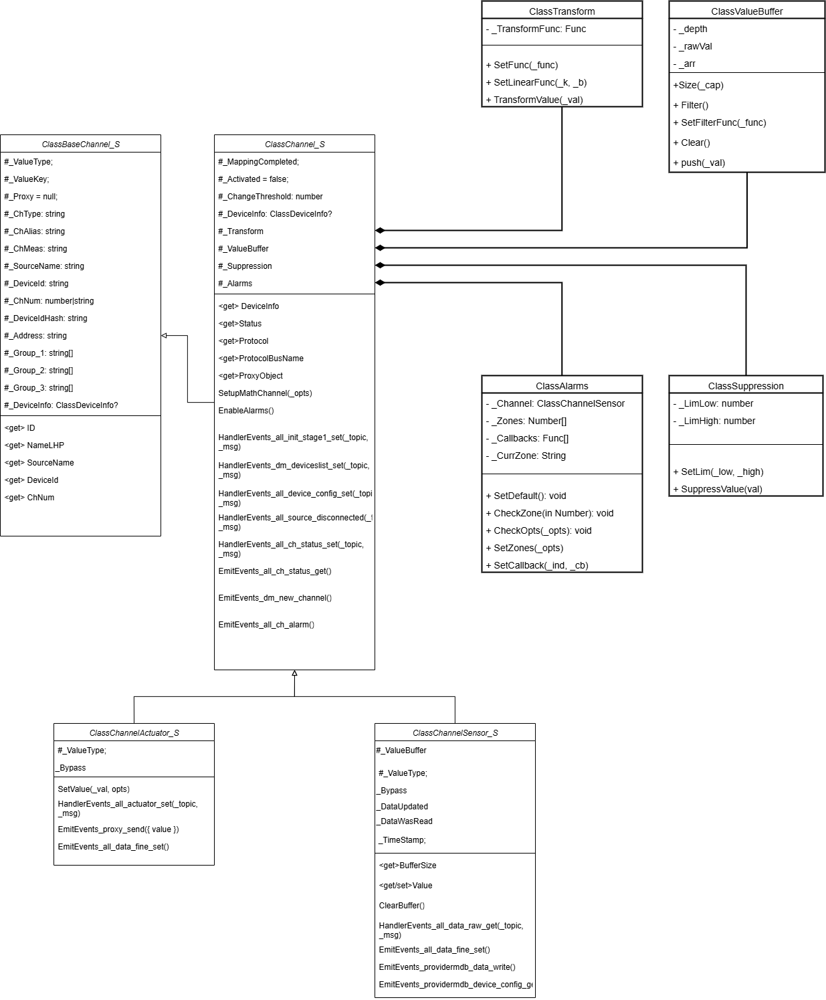

<div style = "font-family: 'Open Sans', sans-serif; font-size: 16px">

# srvChannelSensor
<div style = "color: #555">
    <p align="center">
    
    </p>
</div>

## Лицензия
////

### Описание
<div style = "color: #555">

**ClassChannelSensor** — это класс, представляющий канал (виртуальный датчик) в качестве службы фреймворка. Как наследник класса **[ClassChannel_S](../../srvChannel/res/README.md)** обеспечивает
- инициализацию службы;
- хранение объекта с информацией о физическом датчике;
- конфигурацию канала (настройку мат. обработки, зон измерения, значений по умолчанию); 
- запись обновляемых значений в БД через службу **providermdb**. 

Собственно служба предназначена для приёма и обработки данных, получаемых от источников с дальнейшей трансляцией обработанных данных на шину, доступную пользователю.

*Name* службы соответствует одноименному свойству в конфигурации.  

<div style="color: #555">
<p align="center">

</p>
</div>

### Конструктор
- _busList - массив шины;
- _busNameList - список имен шин;
- _advOpts - объект, содержащий настройки канала (имя источника, идентификатор устройства и номер канала).

Пример конфигурации:
```js
{ 
    ChStatus: "active", 
    ChType:   "sensor",  
    Name:     "mqtt-Temp1",    
    ChMeas:   "C",      
    SourceName: "Broker01", 
    DeviceId:   "adam",   
    ChNum: 2, 
    DeviceHash: "e8fb-b1b0-2899-488d", 
    Address:    "Advantech/00D0C9F712B4/data", 
    ValueKey:   "ai3", 
    Config: { transform: { k: 100, b: -50.0 } },
    SavingValues: { raw: false, fine: false }
}
```

### Поля

- #_Value — текущее значение канала;
- #_ValueAvg — усреднённое значение канала (вычисляется из буфера усреднения `this.Buffer`);
- #_ValueMin — минимальное зафиксированное числовое значение канала;
- #_ValueMax — максимальное зафиксированное числовое значение канала;
- _Bypass — флаг, указывающий, что необходимо пропускать математическую обработку значения `Value`; устанавливается пользователем либо автоматически (если `ValueType == 'string'`);
- _DataUpdated — флаг, указывающий, что `Value` обновился;
- _DataWasRead — флаг, указывающий, что `Value` еще не был считан;
- _TimeStamp — временная метка последнего обновления `Value`;

### Аксессоры

- get Value — возвращает текущее обработанное (и отфильтрованное при наличии `Config.filter`) значение канала;
- get ValueAvg — возвращает усреднённое значение из `this.Buffer`;
- get ValueMin — возвращает минимальное зафиксированное значение канала;
- get ValueMax — возвращает максимальное зафиксированное значение канала;
- get ChName - Возвращает имя канала согласно имеющейся информации об устройстве;
- get ChAlias - Возвращает alias канала;
- get ChMeas - Возвращает строковое обозначение единицы измерения показаний канала;
- get ChType - Возвращает строковое тип канала "сенсор" | "актуатор";
- get DeviceIdHash - Возвращает ID устройства, к которому относится канал;
- get Status - "active"/"inactive" в зависимости от того было ли выполнено маппирование с каналом источника и подключен ли источник в данный момент.


### Подписки

- '<chName>-data-raw-get' — адресное показание канала, поступившее от источника (приходит по протокольной шине или `dataBus` для `virtual`).
- 'all-data-raw-get' — *(deprecated, оставлен для совместимости)* общее событие показания канала, поступившее от источника.
Формат сообщения: 
```js
{
    metadata: { ... },
    com: '<chName>-data-raw-get',
    arg: ['source1_name'],
    value: [
        {
            com: '<chName>-data-raw-get',
            arg: ['<chName>'],
            value: [ x ]
        }
    ]
}
```
Также **ClassChannelSensor** реализует [подписки](../../srvChannel/res/README.md/#подписки) базового класса

### Исходящие сообщения
- 'all-data-fine-set' — сообщение с последним обработанным значением канала; транслируется на **dataBus**. 
Сокращенный формат сообщения: 
```js
{
    com: 'all-data-fine-set',
    arg: ['source1_name-00-01'],
    value: [ {
        Name,
        Value,
        ValueAvg,
        ValueMin,
        ValueMax,
        ValueSuppressed,
        ChName,
        ChAlias,
        ChMeas,
        CurrZone
    } ]
}
```

### Методы
- HandlerEvents_all_init_stage1_set(_topic, _msg) - Обрабатывает команду 'all-init-stage1-set' на инициализацию службы: подписывается на `<chName>-data-raw-get`, `all-data-raw-get` *(deprecated)* и `dm-deviceslist-set` на транспортной шине;
- OnDataRaw(_value) - Обрабатывает raw-значение от источника (обновляет `Value`, применяя при наличии `Config.filter` фильтрацию перед записью в буфер усреднения `Buffer`);
- SetValue(_val) - Устанавливает значение канала (используется в т.ч. при обновлении `StateChName`);
- ResetMinMax() - Сбрасывает накопленные `ValueMin` и `ValueMax` к текущему числовому `Value` (или `undefined`);
- BuildFinePayload() - Формирует payload для `all-data-fine-set` с полями `ValueAvg`, `ValueMin`, `ValueMax`, `ValueSuppressed`;
- EnableAlarms() - Инициализирует объект ClassAlarms для работы с тревогами.

### Пример использования
```js
const channelSensor = new ClassChannelSensor({ _busList, _busNameList }, { sourceName, deviceId, chNum }, _deviceInfo);
```

</div>

</div>